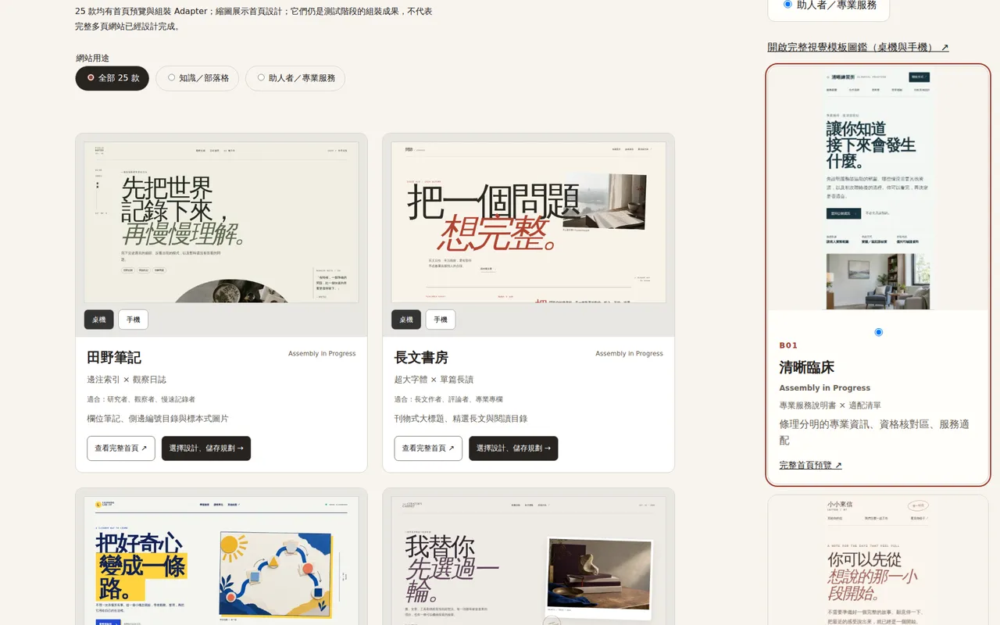

# 25 款 Layout 縮圖盤點與驗收

基底：main `a37bc3ef0469a67b25e3f6fdea448b9526815722`。PR #56 未合併，本 PR 不覆寫其變更。

所有 Registry 狀態目前為 `in-progress`，都有 Adapter 定義，沒有任何一款因補縮圖升級為 Ready。預覽路由是首頁 Prototype；Adapter 存在不等於獨立多頁網站已完成視覺／功能 QA。

| Slug | 中文名稱 | 類型 | 預覽路由 | 原始圖片 | 本輪處理 | 組裝狀態 |
|---|---|---|---|---|---|---|
| field-notes | 田野筆記 | knowledge | /layouts/field-notes/ | Desktop＋Mobile | 保留 2 張 | in-progress |
| essayist | 長文書房 | knowledge | /layouts/essayist/ | Desktop＋Mobile | 保留 2 張 | in-progress |
| learning-lab | 學習實驗室 | knowledge | /layouts/learning-lab/ | Desktop＋Mobile | 保留 2 張 | in-progress |
| curator | 收藏者目錄 | knowledge | /layouts/curator/ | Desktop＋Mobile | 保留 2 張 | in-progress |
| radio-letter | 聲音通信 | knowledge | /layouts/radio-letter/ | Desktop＋Mobile | 保留 2 張 | in-progress |
| reading-atlas | 閱讀年鑑 | knowledge | /layouts/reading-atlas/ | Desktop＋Mobile | 保留 2 張 | in-progress |
| clinician | 清晰臨床 | helper | /layouts/clinician/ | Desktop＋Mobile | 保留 2 張 | in-progress |
| companion | 溫柔陪伴 | helper | /layouts/companion/ | Desktop＋Mobile | 保留 2 張 | in-progress |
| somatic | 身體與節律 | helper | /layouts/somatic/ | Desktop＋Mobile | 保留 2 張 | in-progress |
| coach | 實作型教練 | helper | /layouts/coach/ | Desktop＋Mobile | 保留 2 張 | in-progress |
| collective | 共好工作室 | helper | /layouts/collective/ | Desktop＋Mobile | 保留 2 張 | in-progress |
| trust-path | 信任路徑 | helper | /layouts/trust-path/ | Desktop＋Mobile | 保留 2 張 | in-progress |
| subject-atlas | 主題標本室 | knowledge | /layouts/subject-atlas/ | 缺兩張 | 新增 2 張 | in-progress |
| practice-compass | 服務羅盤 | helper | /layouts/practice-compass/ | 缺兩張 | 新增 2 張 | in-progress |
| sidebar-journal | 側欄日誌 | knowledge | /layouts/sidebar-journal/ | 缺兩張 | 新增 2 張 | in-progress |
| editorial-frontpage | 個人刊物 | knowledge | /layouts/editorial-frontpage/ | 缺兩張 | 新增 2 張 | in-progress |
| card-journal | 卡片刊物 | knowledge | /layouts/card-journal/ | 缺兩張 | 新增 2 張 | in-progress |
| visual-stories | 影像故事 | knowledge | /layouts/visual-stories/ | 缺兩張 | 新增 2 張 | in-progress |
| compact-dispatch | 極簡短箋 | knowledge | /layouts/compact-dispatch/ | 缺兩張 | 新增 2 張 | in-progress |
| split-reader | 雙欄閱讀台 | knowledge | /layouts/split-reader/ | 缺兩張 | 新增 2 張 | in-progress |
| portrait-profile | 人物名片 | helper | /layouts/portrait-profile/ | 缺兩張 | 新增 2 張 | in-progress |
| service-catalogue | 服務目錄 | helper | /layouts/service-catalogue/ | 缺兩張 | 新增 2 張 | in-progress |
| studio-chapters | 工作室章節 | helper | /layouts/studio-chapters/ | 缺兩張 | 新增 2 張 | in-progress |
| editorial-practice | 觀點服務誌 | helper | /layouts/editorial-practice/ | 缺兩張 | 新增 2 張 | in-progress |
| question-led-practice | 問答對話 | helper | /layouts/question-led-practice/ | 缺兩張 | 新增 2 張 | in-progress |

## 原始資產核對

原始 24 張皆能完整解碼，SHA-256 與既有 Manifest 相符；已目視檢查首頁 contact sheet，沒有空白或錯誤頁。原始 12 款首頁路由及相關樣式相較 capture commit `0975ecf` 沒有變更，保留原檔。

## 頁面整合

`/layouts/` 為主要方向探索入口，使用實際截圖替換氛圍圖與文字構圖；`/templates/` 延用既有桌機／手機比較模式，改用同一份 25 款 Registry；`/starter/` 使用同一份 Registry 並顯示全部縮圖，手機選用 mobile 圖。三者不混用 Theme Demo。

## 驗收狀態

- 本機 `npm run build`：通過（207 pages、Pagefind、既有靜態輸出檢查）。
- 捕捉 Workflow：50 路由／圖片檢查已在初輪通過；50 張完整解碼、SHA-256、來源 route/slug 檢查通過；保留 24 張、新增 26 張。
- 既有 Verify Cloudflare Static Assets：未通過。`WorkshopNav.astro` 缺少 QA responsibility declaration，該元件與 QA Registry 不是本輪變更；可用 `node scripts/test-all-component-coverage-regressions.mjs` 重現。其後步驟跳過，Remote ZIP 黑箱檢查亦因本機 `public/builder-pack-version.json` 未產生而失敗。不得將此 workflow 宣稱全綠。
- 舊版初輪圖庫 QA：發現 client Registry import 遺漏與 hidden lazy-image decode 等待問題，已修正；舊執行結果不作通過證據。

## 圖庫專項瀏覽器證據

[Workflow 39226380700](https://github.com/pikaOne1138/astro-personal-site-starter/actions/runs/39226380700) 通過：三個入口 × 1440/1280/768/390，均無水平溢出或破圖；25 款 query 預選與 Site Brief slug/kind 完全相符，圖庫選用連結及手機切換通過，無瀏覽器 JS 錯誤。

[16 張實際桌機／手機截圖與 JSON](https://github.com/pikaOne1138/astro-personal-site-starter/actions/runs/39226380700/artifacts/12174042685)。已目視原始 24 張和新增 26 張的首頁 contact sheet。手機選版卡原本高度太矮，會把主標題裁在下緣，本輪改為 180×390 的直式預覽窗（沿用既有圖鑑手機寬度，顯示約原始 390×844 視窗），不修改原始 WebP；已在最終程式 commit `187978c806bbc4755062fec1678923cc34d7edfb` 回歸通過。

WorkshopNav 的 CI 修復由另一個對話負責，本 PR 不修改其元件或 QA Registry。

## 範圍限制

這次驗收的是縮圖捕捉、選版入口與預選，不是 25 套獨立 Starter 全站驗收。Safari、Firefox、真機、螢幕閱讀器未測。PR 保持 Draft；不 Merge，不發布 Production。

## 最終驗收（程式 commit 187978c）

- [Template Gallery QA](https://github.com/pikaOne1138/astro-personal-site-starter/actions/runs/39228563741)：PASS，含 Build、50 路由／圖片檢查、三入口 × 四尺寸、25 預選與 Site Brief、手機切換、JS errors。37 筆測試結果：`evidence/results.json`。
- [最終 16 張瀏覽器原圖與 JSON](https://github.com/pikaOne1138/astro-personal-site-starter/actions/runs/39228563741/artifacts/12176521442)。`evidence/desktop-mobile.webp` 是其中桌機圖鑑與手機 Starter 的等比例裁切並排；完整未裁切原圖見 Actions Artifact。
- 最終圖片在 GitHub 的 Blob SHA 與本機資產完全一致，50 張均有不同 SHA-256，沒有拿其他版型圖片充數。
- 修正後的 390px Layout 卡片與 Starter 卡片已目視複查。最終程式的 1440/1280/768/390 均無破圖／水平溢出；未宣稱所有字體、對比與完整多頁功能皆完成 QA。
- Cloudflare immutable Preview（187978c）：https://964c18cf.personal-site-starter.pages.dev/ 。已用連接的 Chrome 實際開啟 `/layouts/`，390px 查看新增縮圖並由主題標本室選用連結進 Starter，slug=subject-atlas / kind=knowledge 正確且無溢出。
- GitHub Pages PR Preview Build（187978c）：PASS；已開啟真實 `/astro-personal-site-starter/pr-preview/pr-57/layouts/` 驗證頁面及子路徑連結。
- Verify Cloudflare Static Assets：FAIL（WorkshopNav 宣告阻擋由另一對話維修）；Standalone Starter Export Check 整套匯出測試回報時仍在執行，不列為通過。其餘 Art Direction 與交接合約 workflows 已通過，但不是本輪完整 Starter 驗收證明。
- 發現並修正本輪手機 CSS 回歸：多個 Astro style 區塊合併後覆寫手機比例，導致 expansions 390px 溢出；已合併 Layout inline styles 並約束圖片框。新增選用連結也不再套用預覽連結的整卡片 Grid/100% 高度。失敗 run 39227725749 不作通過證據。

## PR #56 合併後同步

已整合 main `7ad95bae10a8c85a184f1ae847248e2e8c3f62d0`。Starter 保留七步流程、選填訪談、Logo 與品牌圖片上傳區及隱藏圖片路徑；版型庫保留 main 的主要選用 CTA，同時維持真實縮圖、手機比例與 25 款 Registry。

整合後本機 npm run build 與 50 張圖片驗證通過；本節之後的新 CI 才代表整合版本，上方 187978c 證據是同步前的歷史基線。
